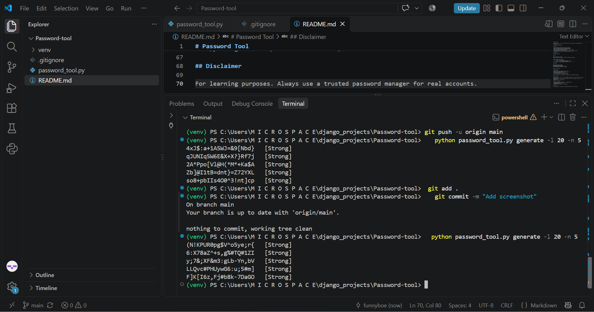

# Password Tool

A command-line tool written in Python that checks how strong a password is and generates secure random passwords.



## Features

- Password strength checker with a score from 0 to 100
- Tips that explain how to make a weak password stronger
- Detects very common passwords and repeated characters
- Secure random password generator using Python's `secrets` module
- Adjustable length, count and symbol use
- Hidden password input, so it doesn't appear on screen or in terminal history
- No external libraries needed, only the Python standard library

## Requirements

- Python 3.8 or newer

## Usage

```
python password_tool.py check
python password_tool.py generate [-l LENGTH] [-n COUNT] [--no-symbols]
```

| Option | Description | Default |
|--------|-------------|---------|
| `-l`, `--length` | Password length (8 to 128) | `16` |
| `-n`, `--count` | How many passwords to generate (1 to 50) | `1` |
| `--no-symbols` | Use only letters and numbers | off |

### Examples

```
python password_tool.py check
python password_tool.py generate
python password_tool.py generate -l 24 -n 5
python password_tool.py generate --no-symbols
```

## How the score works

| Part | Points |
|------|--------|
| Length (8, 12 or 16+ characters) | up to 40 |
| Lowercase, uppercase, numbers, symbols | 15 each |
| Many repeated characters | -10 |
| Shorter than 10 characters | capped at "Weak" |
| Very common password | capped at "Very weak" |

Ratings: **Strong** (80+), **Good** (60+), **Weak** (40+), **Very weak** (below 40).

## Security notes

- The generator uses `secrets`, which is designed for passwords. The `random` module is not secure enough for this.
- The checker reads the password through a hidden prompt, so it never appears on screen or in command history.
- Nothing is saved or sent anywhere.

## Ideas for improvement

- Check passwords against a larger list of leaked passwords
- Passphrase generator (random words)
- Estimate time to crack
- Copy the generated password to the clipboard

## Disclaimer

For learning purposes. Always use a trusted password manager for real accounts.